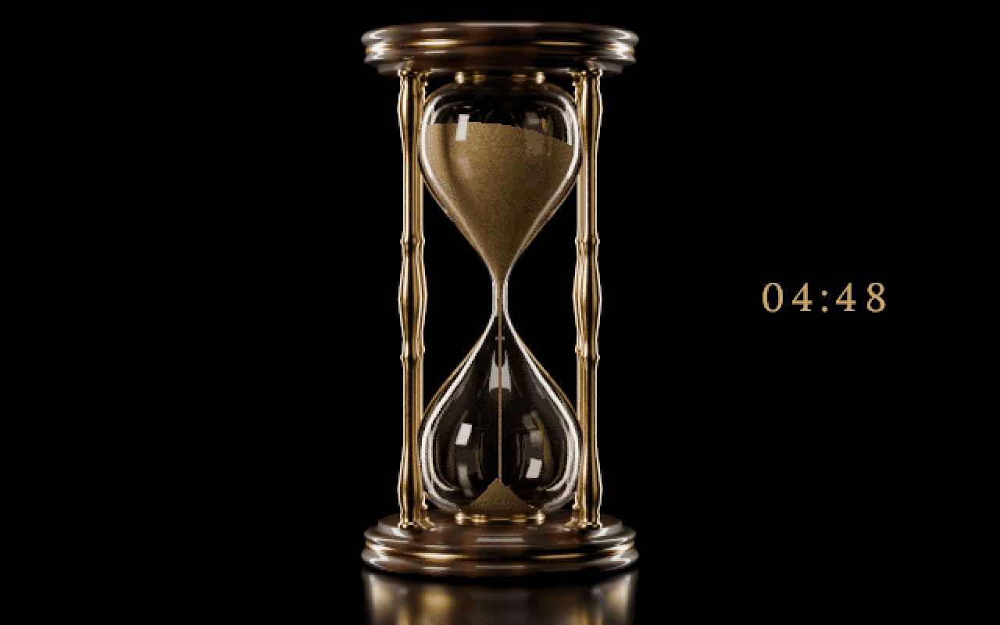
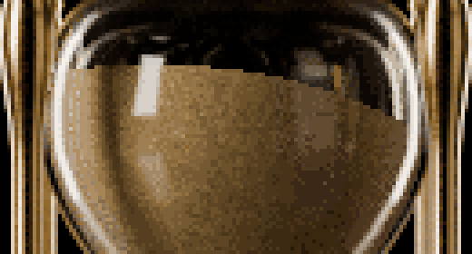

# The Hourglass

A vintage hourglass of walnut and gold for the MEGA65, and a timer: set it from 5 minutes to an
hour, in steps of 5, turn it, and the upper bulb runs empty in exactly the time you chose.

It is a demonstration of our physics engine too. Its sand is simulated in three dimensions, frame by
frame, as a real hourglass holds it: in the lower bulb the stream builds a cone that grows by
avalanches at the angle of repose; in the upper bulb the sand drains as a whole from a surface that
sinks, tilted after each turn the way a real one is, and level by the middle of the run. None of it
is an animation. And it is a demonstration of sound: what you hear comes from the same physics, a
soft burst from the SIDs for every parcel of sand that lands on the pile and the hiss of the stream
while it runs, then a bell of three strikes when the last of it lands.

Version 1.1, 6 November 2026.

A 47-second video, with sound: [docs/the-hourglass.mp4](docs/the-hourglass.mp4). A five-minute
run: the turn and its first twelve seconds as they happen, the sand's sound switched off and on
again with S, the middle twelve times faster and silent, then the last of the sand and the bell.

## Run

Needs a MEGA65. Made for PAL (50 Hz); the engine keeps time in NTSC (60 Hz) too, but that has run
only in an emulator.

1. Download `HOURGLASS.D81` from the [latest release](https://github.com/psincosoft/hourglass/releases/latest)
   and copy it to the SD card.
2. `MOUNT "HOURGLASS.D81"`
3. `LOAD"*",8,1`, then `RUN`

The disk's SHA-256: `81aabe91ed8409a0599e92d206ef7c369da463baa94f51033813dacbb2c7b78e`.

The opening card, then the hourglass, its sand at rest in the lower bulb.

## Keys

| Key | What it does |
|---|---|
| CRSR left and right, or the stick | the time, 5 minutes to 1 hour in steps of 5, while the glass rests |
| RETURN, SPACE, or FIRE | turn the glass. While it runs too: what has fallen runs back, as in a real hourglass |
| S | the sand's sound, off and on |
| B | the bell, off and on (a bell that sounds stops) |
| Q or RUN/STOP | the end |

S and B show the new setting to the left of the glass for two seconds, then it fades. Both start
on. Both joystick ports work.

## What is in it

- **A timer.** The clock beside the glass counts down the time left. The neck lets the sand
  through at the rate that empties the upper bulb in the time chosen, from 5 minutes to an hour.
- **The physics.** Our own engine, in machine code on the MEGA65's 40 MHz processor, keeps the
  sand in rings round the glass's axis, each with its own height, and moves it frame by frame: the
  stream falls with gravity from the neck to the pile, the pile slides outward ring by ring while
  it is steeper than sand stands, and the upper surface sinks as a whole. The camera sees the sand's
  outside, as it lies against the glass. The longer the time, the thinner the stream.
- **The turn.** Each turn tilts the upper surface anew, up to 16.18 degrees, in any direction, in
  the shape a real hourglass's takes after a turn. The tilt fades as the sand runs; by the middle
  of the run the surface is level.
- **The sound.** Made by the SIDs from the physics, as it happens: a short burst of noise for each
  parcel of sand that lands, the hiss of the stream, softer when the stream is thinner. When the
  last of it lands, a bell on two more SIDs. No sample is used.
- **The picture.** The hourglass is rendered with Blender from a scene built in code, and shown on
  the 80 x 50 text screen in full-colour characters: 640 x 400 pixels in 256 colours.

## New in 1.1

The sand in three dimensions. Version 1.0 moved 6,336 grains of sand, a pixel each, in a
cross-section of the glass: the crater over the neck opened as a V from the neck to the walls. In
a real hourglass the sand is a body of revolution and you see its outside. We measured a real one
on video, frame by frame, and 1.1 follows it: the cone below, the sinking surface above, its tilt
after the turn and how the tilt fades.

## Pictures

The pictures and the video are made on a PC from a model of the program that its engine matches
byte for byte, every frame; the sound is the same writes to the SIDs, played through an emulated
6581. They are not photographs of the machine.

## Tested on

A MEGA65 (R6A) in PAL, core 890-sdcard-native build #63 (commit 1c737937), ROM 920422.

## Credits

The Hourglass 1.1, 2026, by Dawid Blachowski, with Claude, Anthropic's AI.
psinco. A Software Atelier from Luxembourg.

- Written with Claude, Anthropic's AI, which wrote the code, built the scene, shaped the sound and
  measured the reference video under Dawid Blachowski's direction.
- The hourglass rendered with Blender.
- The clock's digits and the settings' letters: the Lora typeface (Cyreal), SIL Open Font License
  1.1.
- Made with Python, NumPy, SciPy, OpenCV, Pillow, py65 and d64; the video with FFmpeg and reSIDfp.

## Terms

The Hourglass is free. You may download it, run it, show it, film it, and share the disk image
unchanged and free of charge. See [LICENSE](LICENSE).
